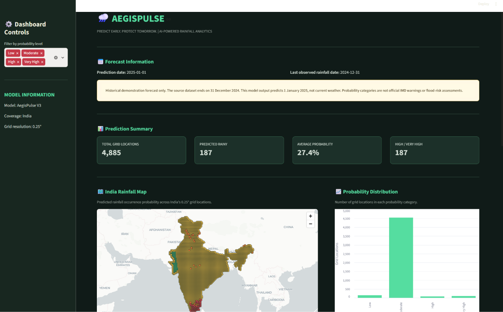

# AEGISPULSE

### Predict Early. Protect Tomorrow.

An AI-powered rainfall prediction and regional risk analysis platform designed to identify potential rainfall events across India using historical rainfall patterns and spatial weather features.

## Overview

AegisPulse is a data science and predictive analytics project that uses historical daily rainfall data from the India Meteorological Department (IMD) to predict the probability of rainfall at individual geographical grid locations.

The platform combines machine learning, spatial analysis, historical rainfall patterns, and interactive visualization to make rainfall predictions easier to explore and understand.

## Dashboard Preview



## Key Features

- **Next-Day Rainfall Prediction:** Estimates the probability of rainfall at geographical grid locations.
- **Spatial Analysis:** Incorporates neighbouring grid locations to capture regional rainfall patterns.
- **Risk Classification:** Groups prediction probabilities into Low, Moderate, High, and Very High categories.
- **Interactive India Map:** Visualizes geographical rainfall predictions.
- **Prediction Analytics:** Displays rainfall probability distributions and key prediction statistics.
- **Regional Analysis:** Provides regional insights across mapped meteorological subdivisions.
- **Streamlit Dashboard:** Presents prediction results through an interactive dashboard.

## Technology Stack

- Python
- Pandas and NumPy
- Xarray and SciPy
- Streamlit
- PyDeck
- Folium
- NetCDF

## Dataset

The project uses daily gridded rainfall data from the India Meteorological Department (IMD).

- **Data period:** 2015–2024
- **Total historical days:** 3,653
- **Geographical grid locations:** 4,885
- **Spatial resolution:** 0.25°

The dataset was cleaned and processed to prepare historical rainfall features for model development.

## Prediction Model

AegisPulse uses a custom logistic regression-based prediction model with 15 input features.

The model incorporates:

- Historical rainfall values
- Previous-day and multi-day rainfall lags
- Rolling rainfall statistics
- Seasonal and calendar features
- Neighbouring-location rainfall statistics

Model V3 achieved the following results on the 2024 chronological test dataset:

| Evaluation Metric | Score |
|---|---:|
| F1 Score | 0.7071 |
| Precision | 0.6485 |
| Recall | 0.7773 |
| Accuracy | 0.8137 |

These results represent historical test performance and do not guarantee future prediction accuracy.

## Spatial Coverage

The regional subdivision mapping covers:

- **4,562** mapped grid locations
- **323** unmapped grid locations
- **34** mapped meteorological subdivisions
- Approximately **93.39%** grid-location mapping coverage

## Project Structure

```text
AegisPulse/
│
├── app.py
├── requirements.txt
├── README.md
├── .gitignore
│
├── screenshots/
│   └── dashboard.png
│
├── data/
│   └── processed/
│       ├── india_grid_subdivision_mapping.csv
│       ├── india_rainfall_cleaned_2015_2024.nc
│       ├── spatial_neighbor_mapping.npz
│       └── predictions/
│           └── aegispulse_next_day_predictions.csv.gz
│
├── models/
│   └── historical_rainfall_model_v3.npz
│
└── src/
    └── [Data processing, feature engineering,
         model training, validation and analysis scripts]
```

## Installation and Setup

### 1. Clone the repository

```bash
git clone https://github.com/akshithayekabote-cmd/AegisPulse.git
```

### 2. Navigate to the project directory

```bash
cd AegisPulse
```

### 3. Create a virtual environment

```bash
py -m venv venv
```

### 4. Activate the virtual environment on Windows

```powershell
venv\Scripts\Activate.ps1
```

### 5. Install dependencies

```bash
py -m pip install -r requirements.txt
```

### 6. Run the Streamlit dashboard

```bash
py -m streamlit run app.py
```

The dashboard will open in your browser.

## Important Limitations and Disclaimer

- The current prediction pipeline uses historical rainfall data ending on December 31, 2024.
- The generated next-day prediction dataset represents a historical demonstration for January 1, 2025, not a live forecast for the current date.
- The model estimates rainfall occurrence probability and does not predict rainfall intensity or flood probability.
- Risk categories are application-defined probability classifications and are not official IMD warning levels.
- AegisPulse is an academic and portfolio project intended for data exploration and predictive analytics.
- Its predictions should not be used as a substitute for official weather forecasts, emergency alerts, or disaster management decisions.

## Project Goal

The goal of AegisPulse is to demonstrate how machine learning, historical weather data, and spatial analytics can be integrated into an interactive platform for exploring rainfall prediction patterns across India.

---

**AegisPulse — Predict Early. Protect Tomorrow.**